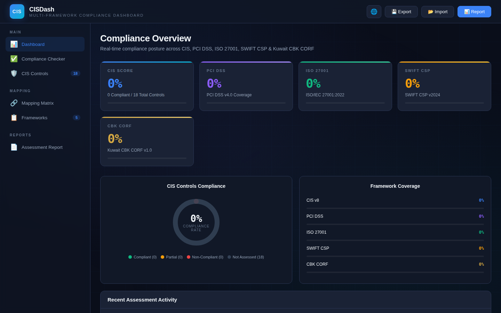
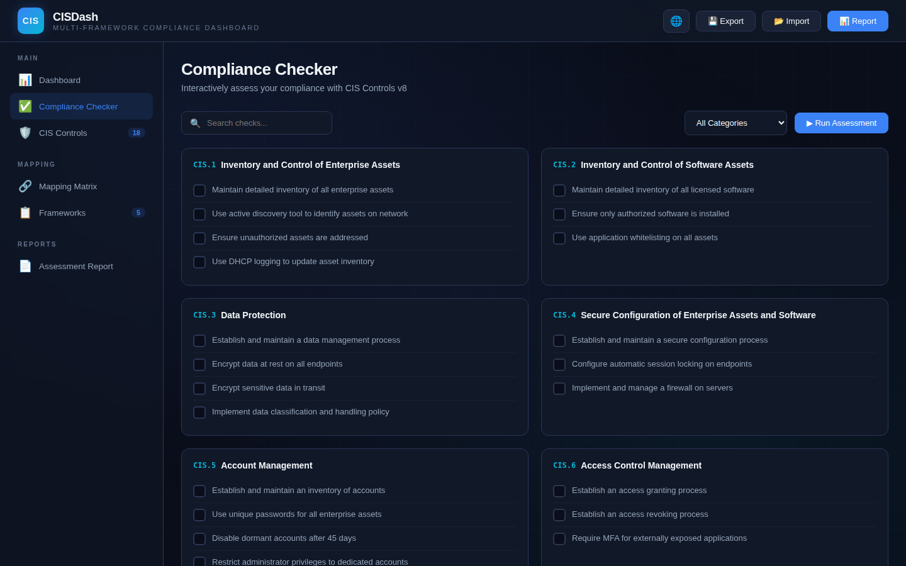
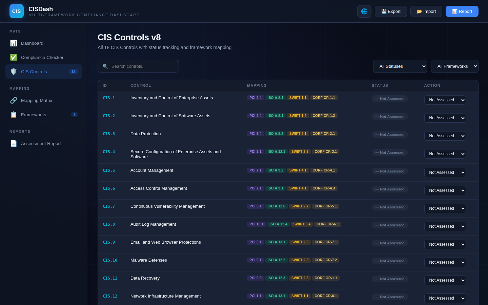
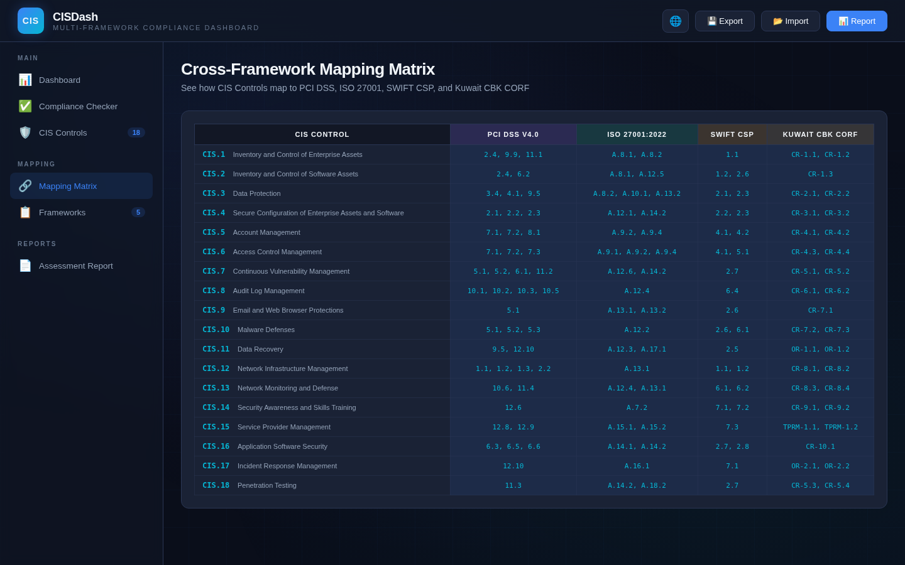
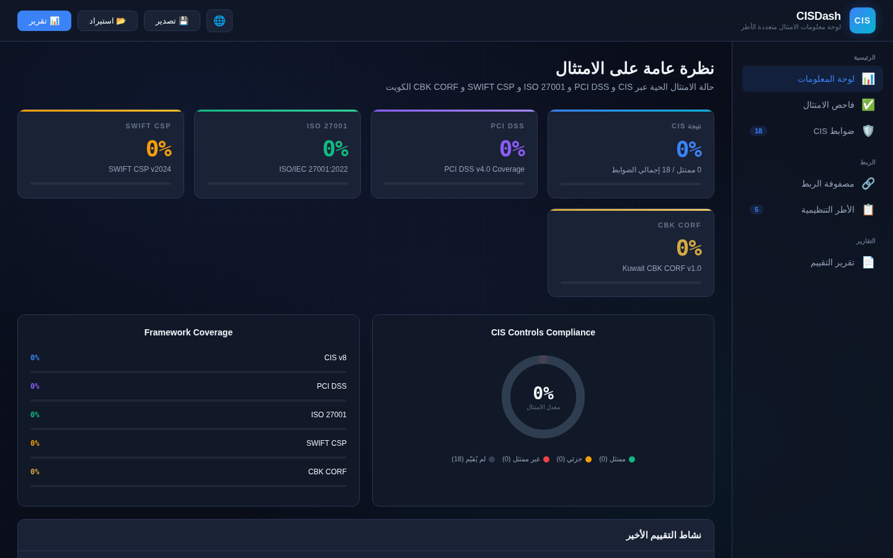
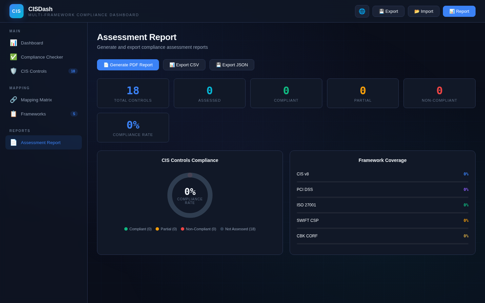

<div align="center">

# 🛡️ CISDash | لوحة الامتثال CIS

### Multi-Framework CIS Compliance Dashboard

[](LICENSE)
[](#-bilingual-support)
[](https://siteq8.github.io/cisdash/)
[](#)

**A comprehensive, zero-dependency web application for CIS Controls v8 compliance assessment with cross-framework mapping to PCI DSS, ISO 27001, SWIFT CSP, and Kuwait CBK CORF.**

[Live Demo](https://siteq8.github.io/cisdash/) · [Report Bug](https://github.com/SiteQ8/cisdash/issues) · [Request Feature](https://github.com/SiteQ8/cisdash/issues)

</div>

---

## 📸 Screenshots

### Dashboard Overview

*Real-time compliance posture across all five frameworks with interactive donut charts and framework coverage bars.*

### Compliance Checker

*Interactive checklist-based assessment tool — check individual controls and run automated scoring.*

### CIS Controls v8 — Full Tracking

*All 18 CIS Controls with status badges, framework mapping tags, and inline status management.*

### Cross-Framework Mapping Matrix

*Complete mapping matrix showing how CIS Controls map to PCI DSS v4.0, ISO 27001:2022, SWIFT CSP, and Kuwait CBK CORF.*

### Arabic Interface (RTL)

*Full Arabic localization with proper RTL layout — built for the Kuwait and GCC cybersecurity community.*

### Assessment Report (Print-Ready)

*Generate comprehensive PDF reports with per-framework scores and detailed control status tables.*

---

## 🚀 Features

### 🎯 Core Compliance Engine
- **All 18 CIS Controls v8** with sub-control checklists (60+ individual checks)
- **Interactive Compliance Checker** — tick-based assessment with automated scoring
- **Per-control status tracking** — Compliant, Partially Compliant, Non-Compliant, Not Assessed
- **Real-time score calculation** across all frameworks simultaneously

### 🔗 Multi-Framework Mapping
| Framework | Version | Coverage |
|-----------|---------|----------|
| **CIS Controls** | v8 (2021) | 18 controls, 60+ sub-controls |
| **PCI DSS** | v4.0 | Full mapping to relevant requirements |
| **ISO/IEC 27001** | 2022 | Annex A controls mapping |
| **SWIFT CSP** | v2024 | Customer Security Programme controls |
| **Kuwait CBK CORF** | v1.0 (Dec 2025) | Cyber Resilience, Operational Resilience, TPRM baselines |

### 🌐 Bilingual Support (English & Arabic)
- **Full Arabic localization** — every label, title, and description
- **RTL layout support** — proper right-to-left rendering
- **One-click language toggle** — switch instantly between EN/AR
- **Arabic control descriptions** — native translations, not machine-generated

### 📊 Dashboard & Visualization
- **Overall compliance score** with animated progress bars
- **Per-framework score cards** — CIS, PCI, ISO, SWIFT, CORF
- **SVG donut charts** — compliance breakdown by status
- **Framework coverage comparison** — side-by-side bar charts
- **Assessment activity timeline** — historical tracking

### 📋 Reporting & Export
- **PDF Report Generation** — print-ready, professional layout
- **CSV Export** — for spreadsheet analysis
- **JSON Export/Import** — save and restore assessment state
- **Assessment History** — track progress over time

### 🎨 Design & UX
- **Dark cybersecurity theme** — navy/blue professional aesthetic
- **Responsive design** — works on desktop, tablet, and mobile
- **Zero dependencies** — pure HTML/CSS/JS, no frameworks needed
- **GitHub Pages ready** — deploy in seconds
- **Keyboard accessible** — full keyboard navigation support

---

## 🏗️ Quick Start

### Option 1: GitHub Pages (Recommended)
Simply visit the live demo:
```
https://siteq8.github.io/cisdash/
```

### Option 2: Local
```bash
git clone https://github.com/SiteQ8/cisdash.git
cd cisdash
# Open index.html in your browser — that's it!
open index.html
```

### Option 3: Docker
```bash
docker run -d -p 8080:80 -v $(pwd):/usr/share/nginx/html:ro nginx:alpine
# Visit http://localhost:8080
```

No build step. No npm install. No dependencies. Just open and assess.

---

## 📖 Usage Guide

### Running a Compliance Assessment

1. **Navigate to Compliance Checker** from the sidebar
2. **Review each CIS Control** and tick the checks your organization meets
3. **Click "Run Assessment"** to auto-calculate compliance scores
4. **View Dashboard** for your overall posture across all frameworks
5. **Export results** as PDF, CSV, or JSON

### Manual Status Override

1. Go to **CIS Controls** page
2. Use the **status dropdown** next to any control to manually set its compliance level
3. Scores update in real-time across all framework views

### Import Previous Assessment

1. Click **📂 Import** in the top bar
2. Select a previously exported `.json` file
3. All control statuses and check marks are restored

---

## 🗺️ Framework Mapping Details

### Kuwait CBK CORF v1.0

The tool maps CIS Controls to all three CORF baselines:

| CORF Baseline | Prefix | CIS Controls Mapped |
|---------------|--------|-------------------|
| Cyber Resilience | CR-x.x | CIS 1–10, 12–14, 16, 18 |
| Operational Resilience | OR-x.x | CIS 11, 17 |
| Third-Party Risk Management | TPRM-x.x | CIS 15 |

### PCI DSS v4.0

Mapped to relevant PCI DSS requirements including:
- **Req 1-2**: Network & system configuration → CIS 4, 12
- **Req 5-6**: Vulnerability & malware → CIS 7, 10, 16
- **Req 7-8**: Access control → CIS 5, 6
- **Req 10-11**: Monitoring & testing → CIS 8, 13, 18

---

## 🛠️ Technical Architecture

```
cisdash/
├── index.html          # Single-file application (everything included)
├── README.md           # This file
├── LICENSE             # MIT License
└── screenshots/        # Application screenshots
    ├── dashboard.png
    ├── checker.png
    ├── controls.png
    ├── mapping.png
    ├── arabic.png
    └── report.png
```

**Tech Stack:**
- Pure HTML5 / CSS3 / JavaScript (ES6+)
- Custom SVG chart rendering (no chart library)
- CSS Grid & Flexbox responsive layout
- IBM Plex Sans + IBM Plex Sans Arabic typography
- JetBrains Mono for code/data elements

---

## 🤝 Contributing

Contributions are welcome! Areas of interest:

- [ ] Additional framework mappings (NIST CSF, SOC 2, NESA)
- [ ] More granular CIS sub-controls
- [ ] Additional language support (French, Urdu, Hindi)
- [ ] Dark/Light theme toggle
- [ ] Historical trend charts
- [ ] Evidence attachment support

---

## 📄 License

This project is licensed under the MIT License — see [LICENSE](LICENSE) for details.

---

## 👤 Author

**Ali AlEnezi** — [@SiteQ8](https://github.com/SiteQ8)

📧 Site@hotmail.com
🇰🇼 Kuwait

---

<div align="center">

**Built for the cybersecurity community 🛡️**

*If this tool helps your compliance work, consider giving it a ⭐*

</div>
